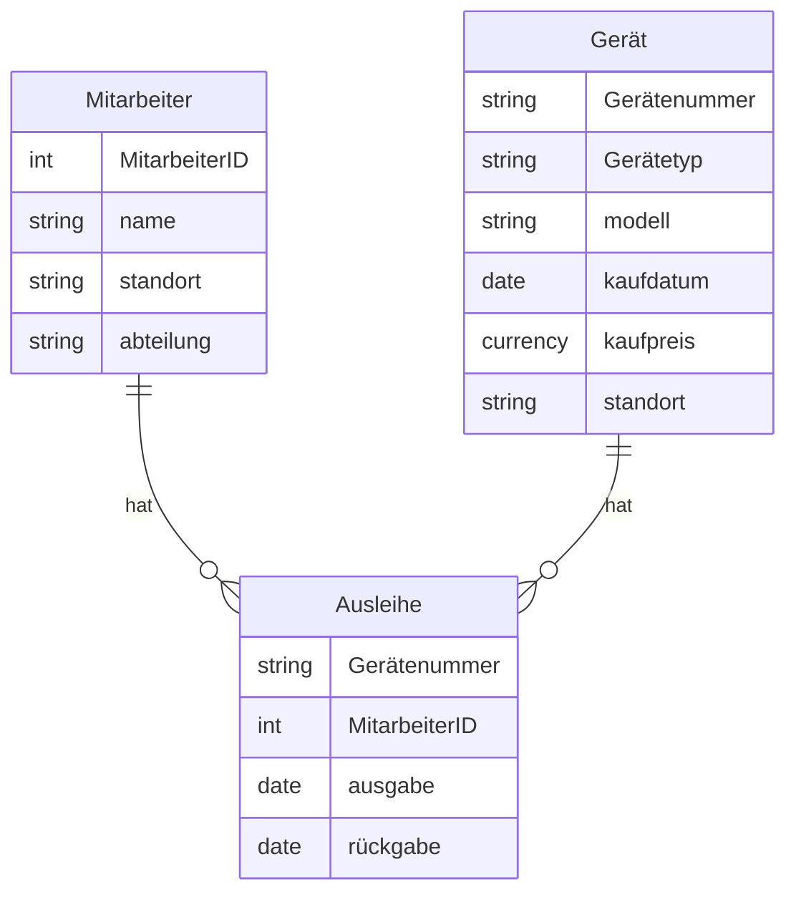

# Anforderungen
Geräte Mitarbeiter Ausleihe.
## Geräte
- haben eine nummer, einen Namen, einen Kaufpreis, kaufdatum, modell und einen Standort
### Regeln
- haben eine aktive zuweisung
- kaufpreis ist in Euro

## Mitarbeiter
- Haben einen Namen, eine Mitarbeiternummer, einen Standort und eine abteilung
### Regeln
- Haben jeweils nur einen Standort
- haben eine einzigartige Nummer

## Ausleihe
- Haben einen Mitarbeiter, sowie ein ausleihdatum,  ein Rückgabedatum, falls schon zurückgegeben und eine GeräteID
### Regeln
- Das Ausleihdatum kann nicht nach dem Rückgabedatum sein
- Dasselbe Gerät kann nicht zeitgleich an zwei verschiedene Personen ausgeliehen sein

# er-Diagramm
